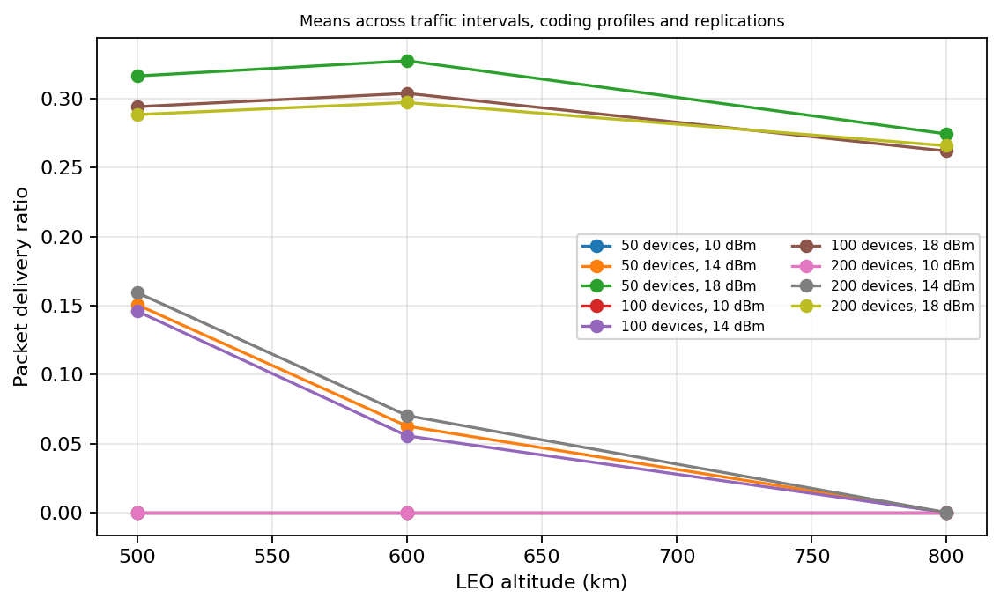
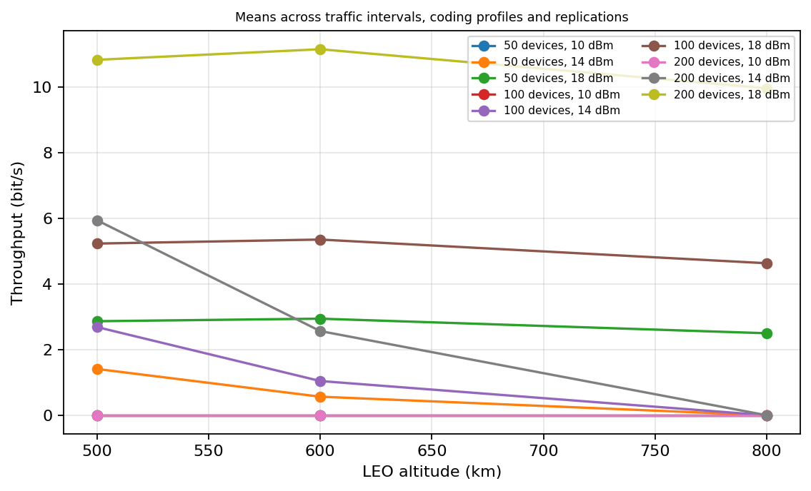
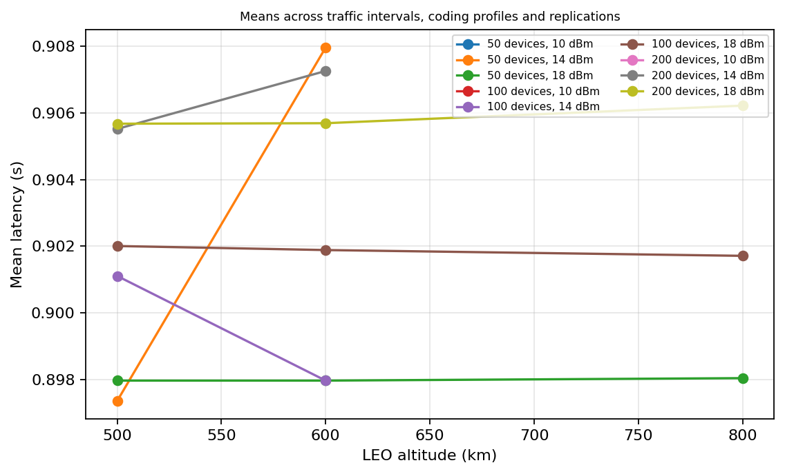
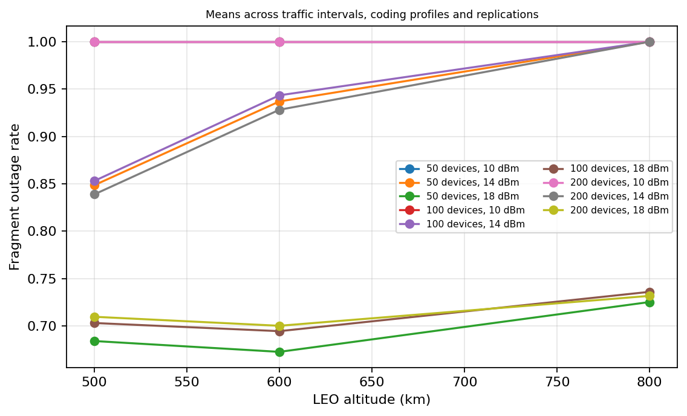

# System-Level Evaluation of LR-FHSS for a Simplified LEO Satellite IoT Uplink

## Abstract

This project follows a defensible research direction: adding satellite geometry
and a link budget to an LR-FHSS random-access simulator is a valid way to study
a simplified direct-to-satellite uplink. It is not a validated satellite mission
simulator or an implementation of a 6G/3GPP air interface. The satellite receiver
is represented by the simulator's base-station object.

The review found a visibility error and several implementation and reporting
defects. The original report is preserved in [Report_legacy.md](Report_legacy.md)
and its 324-run data remain in [results_small](results_small/ntn_results.csv).
Those results describe the former synthetic model, not the corrected model.
The new [324-run matrix](results_reviewed/ntn_results.csv) has mean finite-window
PDR 0.1212 and throughput 2.58 bit/s under an illustrative receiver sensitivity
of -133.03 dBm. That sensitivity is not calibrated to an LR-FHSS receiver;
these results demonstrate model behavior, not real satellite performance.

## 1. What scenario is represented?

The model represents many colocated ground terminals transmitting to one
receiver on a circular LEO satellite orbit. Every terminal shares the same
time-varying elevation, distance and link-budget configuration. This is a
**single-site, single-satellite, system-level uplink model**. It can investigate
interactions between an assumed link budget, access windows and contention.
It cannot establish geographic coverage, constellation capacity, handover,
waveform robustness, or end-to-end latency. NTN is an appropriate research
context; calling this a validated 6G satellite evaluation would overstate it.

The [upstream repository](https://github.com/Xexell/LR-FHSS-sim) provides modular
LR-FHSS event simulation. Its authors describe its scenario-independent design
and extensions in the [simulator paper](https://oulurepo.oulu.fi/bitstream/handle/10024/51865/nbnfioulu-202409165876.pdf?isAllowed=y&sequence=1).
An orbital scenario must be supplied by the researcher.

## 2. Review findings

| Finding | Effect | Resolution |
|---|---|---|
| Elevation oscillated between the elevation mask and 90 degrees | Moving satellite was always visible | Circular overhead geometry now includes below-horizon intervals |
| Same 5760 s period at every altitude | Motion inconsistent with altitude | Default period follows Kepler's circular-orbit relation |
| Doppler always nonnegative and inconsistent with range change | Approaching/receding motion not represented | Signed range-rate Doppler; still diagnostic only |
| Unexplained 125 kHz noise bandwidth and -15 dB threshold | Outage conclusions depend on unvalidated sensitivity | Retained as an explicit illustrative pair; sensitivity exported |
| Matrix compared 1/3 and 1/2 payload codes with three headers | Not the usual LoRaWAN LR-FHSS profile comparison | New matrix uses 1/3 with three headers and 2/3 with two |
| No-success runs had zero latency | Downward-biased overall latency | Missing values instead; overall report uses packet weighting |
| No-transmission runs had PDR 1 | Empty experiment looked reliable | Structured metrics return missing PDR |
| Channel RNG not reset; access calculation consumed random draws | Reused settings could change shadowing results | Seed reset per run; access integrates shadowing without RNG draws |
| Constant traffic accessed undefined self.transmitted | Generator could crash | Explicit first-transmission state |
| ACRDA removed items from the transmitter's fragment list | Short windows could skip scheduled fragments | Receiver filters without mutating transmission sequence |
| ACRDA omitted latency recording | Successful runs could report zero latency | Decode time and latency recorded once |
| Collision counts taken at fragment completion, after possible SIC | Inconsistent fragment cohorts and undercounting | Count each started fragment once when overlap occurs |
| Touching airtime endpoints could collide | Event-order-dependent false collisions | Half-open airtime intervals |
| Settings.tx_power_dbm was ignored | Power overrides had no effect | Explicit override updates a copied channel configuration |
| Report assigned 0.9068 PDR to 500 km / 18 dBm | Marginal mean confused with joint mean | Actual historical joint mean is 0.9989 |

Constant-traffic and ACRDA list-mutation defects already existed in the upstream
code in local history. They were not introduced by the satellite extension.
The original reported matrix used exponential traffic and the core receiver,
so those two defects did not affect its results.

## 3. Geometry and receiver assumptions

Assume a spherical, nonrotating Earth of radius R = 6371 km, a fixed ground
site, and an orbit of radius r = R + h passing directly overhead. For central
angle theta between the ground site and subsatellite point:

```text
d = sqrt(r^2 + R^2 - 2*r*R*cos(theta))
elevation = atan2(r*cos(theta) - R, r*abs(sin(theta)))
T = 2*pi*sqrt((1000*r)^3 / mu), mu = 3.986004418e14 m^3/s^2
theta(t) = theta(0) + 2*pi*t/T
```

Initial elevation is 45 degrees on the approaching side; visibility requires
at least 10 degrees. An explicit nonpositive orbit_period_s selects a static
link; a positive value overrides the Kepler period for controlled experiments.
This is not a prediction for a particular orbit plane or geographical location.

```text
FSPL = 20*log10(4*pi*d_m*f/c)
Pr_dBm = Pt_dBm + Gt_dBi + Gr_dBi - FSPL - shadowing_dB
N_dBm = -174 + 10*log10(B_Hz) + NF_dB
SNR_dB = Pr_dBm - N_dBm - implementation_loss_dB
```

The matrix retains f = 868 MHz, antenna gains = 0 dBi, noise figure = 5 dB,
B = 125 kHz, required SNR = -15 dB, and zero shadowing and implementation loss.
The received-power threshold is therefore **-133.03 dBm**. At 600 km overhead,
FSPL is approximately 146.78 dB; a 14 dBm transmitter produces -132.78 dBm,
only about 0.25 dB above threshold. Small parameter changes matter greatly.

LR-FHSS instantaneous modulation bandwidth is approximately 488 Hz; hopping
bandwidth and equivalent decoder noise bandwidth are different quantities.
The profile definitions are documented in the
[LoRa Alliance RP002-1.0.3 specification](https://lora-alliance.org/wp-content/uploads/2021/05/RP-2-1.0.3.pdf).
Replacing 125 kHz with 488 Hz while keeping -15 dB would improve the assumed
sensitivity by about 24.1 dB. That is a different receiver assumption, not a
validated correction. Use measured sensitivity or a justified bandwidth and
threshold pair, ideally for each coding profile, before making link claims.

Doppler is -f/c times range rate: positive approaching and negative receding.
It does not move fragments between modeled channels or impair decoding.
Propagation delay is absent from event timing. At 600 km overhead it would
be about 2 ms one way. Reported latency is thus a transmission/decoder metric,
not satellite end-to-end latency.

## 4. Methodology and metrics

The corrected matrix uses altitudes 500/600/800 km, 50/100/200 terminals,
300/900 s mean idle intervals, powers 10/14/18 dBm, two profiles (1/3 with
three headers; 2/3 with two headers), and three replications: 324 runs of
600 s each. Seeds are 20261012 plus the replication index.

All runs begin at the same approaching elevation. These are short observation
windows, not whole-orbit averages. Traffic is an exponential wait after the
previous packet finishes; the interval parameter is a mean idle interval, not
exactly a mean inter-start interval. Packets use 10 payload bytes and the
upstream single grid of 35 modeled channels. Counts refer to this grid, not
a fully modeled multigrid network. Hops are independent random channel choices,
not the standard's full hopping-sequence generator.

| Metric | Definition |
|---|---|
| PDR / PSR | Decodes before cutoff / transmission starts before cutoff; missing if no starts |
| Throughput | Successfully decoded payload bits / observation duration |
| Latency | Transmission start to successful decode; missing if none succeed |
| Collision rate | Started fragments encountering overlap / started fragments |
| Outage rate | Started fragments failing the link test / started fragments |
| Access fraction | Expected usable-link fraction over the idealized orbit |
| Window access fraction | Expected usable-link fraction over the observation window |
| Unfinished packets | Transmissions still ongoing at cutoff, including any decoded early |

Collision and outage can affect the same fragment. Their rates cannot be added
or treated as exclusive packet-loss causes. Below-mask fragments still enter
the simplified overlap accounting. There is no received-power capture or SINR
model. Fragment availability is sampled at fragment start. There is no buffering
for later passes, retransmission, acknowledgement or visibility-aware scheduler.

The simulation does not drain in-flight packets after cutoff. Unfinished packet
counts expose this boundary condition but are not counts of definite failures.
Longer runs or a defined arrival cohort with a drain interval would be needed
for a different, steady-state PDR interpretation.

Tables use arithmetic means of run-level metrics over the specified matrix.
Overall latency instead weights each run by successful packet count.
[summary.csv](results_reviewed/summary.csv) gives per-configuration replication
means, sample standard deviations and valid counts. These are not confidence
intervals, and three replications do not establish significance. Equal seeds
across profiles do not ensure identical traffic because hopping draws and
airtime change. Independent traffic and hopping RNG streams would be needed
for strict paired comparisons.

## 5. Results

| Metric | Historical matrix | Corrected matrix |
|---|---:|---:|
| Mean PDR | 0.3822 | 0.1212 |
| Mean throughput (bit/s) | 7.9786 | 2.5819 |
| Mean fragment outage | 0.6172 | 0.8780 |
| Mean collision rate | 0.0184 | 0.0160 |
| Mean whole-orbit access | 0.2846 (nonphysical pass) | 0.0144 |
| Mean observation-window access | Not exported | 0.1225 |
| Successful-packet-weighted latency (s) | 1.0219 | 0.9024 |

The historical 0.453 s latency included zero values from unsuccessful runs;
it was not mean latency among delivered packets. The report also assigned
its all-altitudes 18 dBm mean PDR (0.9068) to 500 km / 18 dBm, whose historical
joint mean is 0.9989.

The new matrix changes geometry, coding profiles and accounting together;
the difference is **not an isolated estimate of any one correction**.
Corrected PDR 0.1212 is close to mean window access 0.1225, consistent with
availability limitations under the assumed receiver. Neither should be compared
with whole-orbit availability 0.0144 as if the observation periods matched.

| Altitude (km) | Corrected mean PDR | Mean throughput (bit/s) |
|---:|---:|---:|
| 500 | 0.1505 | 3.2198 |
| 600 | 0.1241 | 2.6259 |
| 800 | 0.0891 | 1.9000 |

| Transmit power (dBm) | Corrected mean PDR | Mean throughput (bit/s) |
|---:|---:|---:|
| 10 | 0.0000 | 0.0000 |
| 14 | 0.0716 | 1.5802 |
| 18 | 0.2921 | 6.1654 |

Corrected joint 500 km / 18 dBm PDR is 0.2996. Profile means are 0.1219 (1/3)
and 0.1206 (2/3). These small differences do not establish equivalence,
especially with a shared uncalibrated SNR threshold. Lower altitude reduces
path loss; this does not imply a universal mission recommendation without
considering access duration, footprint and revisit.









Plot curves average over idle intervals, profiles and replications. Latency
plots exclude unsuccessful runs and equally weight remaining run means;
the overall latency table above instead uses successful-packet weighting.

## 6. Validity and next research steps

The slant-range and free-space-loss calculations fit the stated assumptions.
The revised geometry has physically consistent visibility and range-rate
behavior within an idealized overhead orbit. Regression tests check these
properties and event-model defects; passing tests is not receiver validation.

The highest priority is to justify receiver sensitivity and antenna gains
against a chosen receiver or measurements. Then study complete passes and
initial phases, and separate visibility outages from insufficient-power outages.
For geographic conclusions, introduce distributed terminal positions and an
inclined orbit over a rotating Earth. TLE/SGP4 helps model a named mission but
is not mandatory for a clearly stated idealized system-level study.

Further work includes residual Doppler and oscillator tolerance, capture,
propagation delay, antenna patterns, shadowing correlation, environmental
losses, and independent traffic RNG streams. ACRDA still assumes ideal
cancellation and is not a calibrated satellite demodulator. The Markovian
traffic generator has not been validated as a general two-state arrival process;
the reported experiments do not use it.

## 7. Reproduction

From the repository root with the project's installed dependencies:

```powershell
.\.venv\Scripts\python.exe -m unittest discover -s tests -v
.\.venv\Scripts\python.exe -m lrfhss.ntn_experiments --output results_reviewed --replications 3 --simulation-time 600
.\.venv\Scripts\python.exe examples/audit_results.py
```

Outputs include raw CSV, per-configuration summaries, four PNGs, and
[manifest.json](results_reviewed/manifest.json) with the model label, experiment
plan, satellite defaults and interpretation notes. Preserve the code revision
alongside these files when submitting or publishing. Existing results_small
and results_quick remain historical; do not overwrite them to reproduce the
corrected model.

The review passed all 20 tests and regenerated all 324 corrected runs. The
project is suitable as a transparent simplified satellite-uplink baseline,
with corrected geometry and explicit receiver assumptions. Mission-performance
claims require additional validation.
