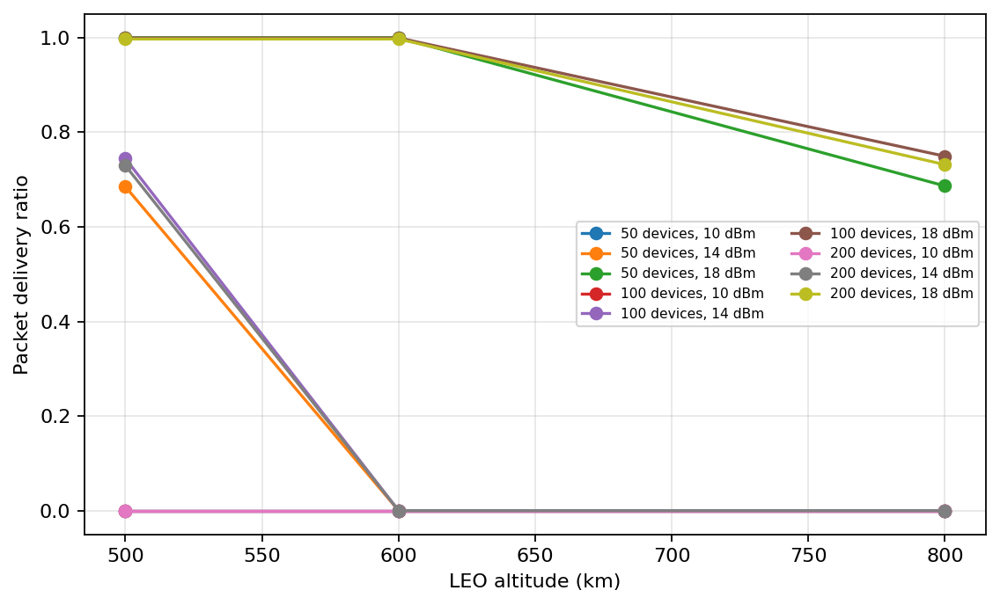
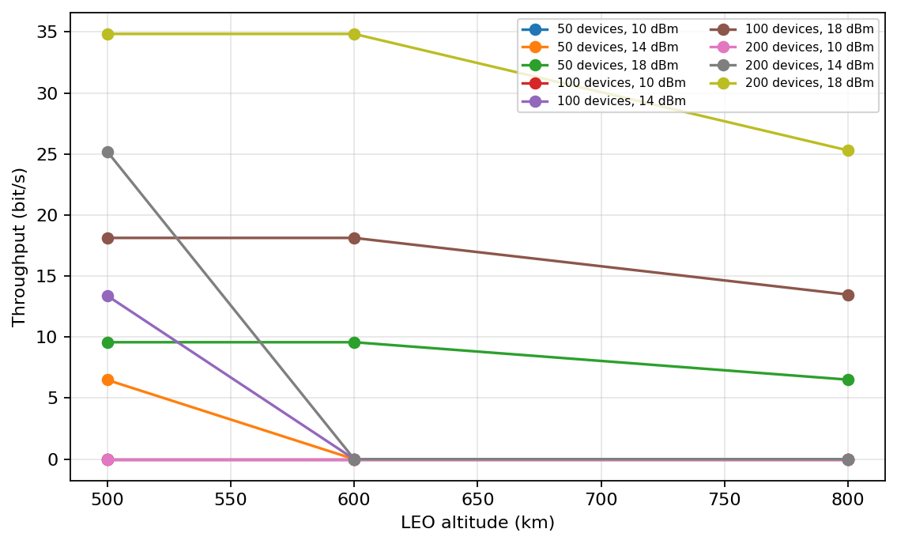
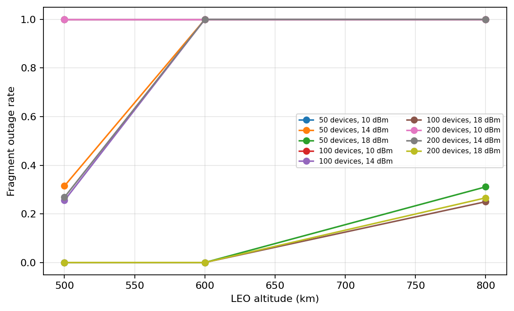
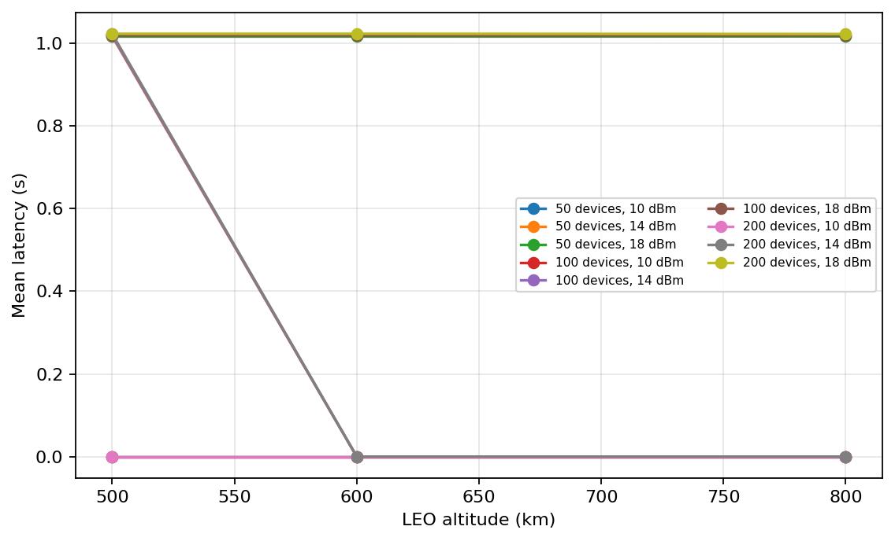

# Performance Evaluation of LR-FHSS for NTN-6G Satellite IoT Communications

## Abstract

This report evaluates LR-FHSS as an uplink technology for low-power satellite
IoT devices. The study extends the event-driven Python simulator in this
repository with an analytical LEO satellite channel. The extension models
satellite altitude, elevation-dependent slant range, free-space path loss,
received power, thermal noise, SNR thresholding, visibility, a synthetic
satellite pass, and an estimated Doppler shift. The LR-FHSS receiver accepts a
fragment only when it is both free of same-channel collisions and within the
link budget.

The reported results are generated from `results_small/ntn_results.csv`, which
contains 324 simulation records and three replications per configuration. The
overall mean PDR is 0.3822, mean throughput is 7.98 bit/s, mean fragment outage
rate is 0.6172, and mean access fraction is 0.2846. Transmit power and
altitude are the dominant factors in this model: the mean PDR increases from
0 at 10 dBm to 0.9068 at 18 dBm, while it decreases from 0.5728 at 500 km to
0.2408 at 800 km.

These numbers are simulator outputs, not measurements from a satellite
mission. They are useful for controlled comparisons and sensitivity analysis,
but they should not be interpreted as a validated prediction of a particular
constellation.

## 1. State of the art

Satellite IoT combines the energy and cost constraints of massive machine-type
communications with the long propagation distances and intermittent visibility
of non-terrestrial networks (NTN). Current approaches can be grouped into
three broad families:

1. **Terrestrial LPWAN adaptation.** Technologies such as LoRaWAN use
   unlicensed sub-GHz spectrum, low-cost devices, and simple star-of-stars
   architectures. They are attractive for delay-tolerant sensing but are
   constrained by link budget, duty-cycle regulations, and collisions.
2. **LR-FHSS.** LR-FHSS replaces a long continuous chirp transmission with
   many short, frequency-hopped fragments. The sparse fragments improve
   interference tolerance and allow a gateway to recover a packet when enough
   headers and payload fragments survive. This makes LR-FHSS relevant to dense,
   low-rate uplinks and satellite coverage scenarios.
3. **3GPP NTN systems.** 3GPP NTN work extends cellular procedures to
   satellite links, including timing, Doppler, coverage, and mobility
   considerations. These systems can provide stronger integration with
   terrestrial networks, but typically require more capable terminals and
   network infrastructure than a very-low-power LPWAN node.

The research problem is therefore not simply whether a packet collides. A
satellite IoT packet can fail because the satellite is below the elevation
mask, because the received SNR is insufficient, or because surviving
fragments are lost to interference. A useful simulator must expose these
effects separately.

Relevant background sources include:

- [LoRa Alliance LR-FHSS overview](https://resources.lora-alliance.org/technical-specifications/lorawanr-regional-parameters)
- [3GPP NTN overview](https://www.3gpp.org/technologies/ntn-overview)
- [3GPP TR 38.811: Study on New Radio support for NTN](https://www.3gpp.org/ftp/Specs/archive/38_series/38.811/)

The present implementation is a system-level research prototype. It does not
claim to implement the complete LoRaWAN or 3GPP protocol stacks.

## 2. Choice of simulator

The selected simulator is
[Xexell/LR-FHSS-sim](https://github.com/Xexell/LR-FHSS-sim), a Python and
SimPy event-driven LR-FHSS simulator.

It was selected for four reasons:

- It already represents packets as headers and payload fragments.
- It already models same-channel fragment collisions.
- It includes both a basic receiver and an ACRDA receiver with successive
  interference cancellation.
- Its Python implementation is easy to extend, inspect, and reproduce on a
  standard laptop.

The original simulator was preserved as the default mode. Satellite effects
are enabled by passing a `SatelliteChannel` to `Settings`; this allows direct
comparison between the original base-station model and the NTN extension.

## 3. Available code

The main implementation is organized as follows:

| File | Role |
|---|---|
| [`lrfhss/lrfhss_core.py`](lrfhss/lrfhss_core.py) | Packets, fragments, nodes, collision detection, and receiver decoding |
| [`lrfhss/settings.py`](lrfhss/settings.py) | Simulation and coding-rate configuration |
| [`lrfhss/traffic.py`](lrfhss/traffic.py) | Exponential, uniform, constant, and Markovian traffic |
| [`lrfhss/acrda.py`](lrfhss/acrda.py) | ACRDA receiver and interference cancellation |
| [`lrfhss/satellite.py`](lrfhss/satellite.py) | LEO geometry and analytical satellite link budget |
| [`lrfhss/run.py`](lrfhss/run.py) | Simulation execution and metrics collection |
| [`lrfhss/ntn_experiments.py`](lrfhss/ntn_experiments.py) | Experiment matrix, CSV export, and graph generation |
| [`tests/test_satellite.py`](tests/test_satellite.py) | Geometry, outage, reproducibility, and integration tests |

The experiment outputs used in this report are in
[`results_small/ntn_results.csv`](results_small/ntn_results.csv). The
corresponding illustrations are:

- [PDR versus altitude](results_small/pdr_vs_altitude.png)
- [Throughput versus altitude](results_small/throughput_vs_altitude.png)
- [Latency versus altitude](results_small/latency_vs_altitude.png)
- [Outage versus altitude](results_small/outage_vs_altitude.png)

### 3.1 Satellite model

For a satellite at altitude \(h\), Earth radius \(R_E\), and elevation
\(\epsilon\), the slant range is calculated as:

\[
d = \sqrt{(R_E+h)^2 - (R_E\cos\epsilon)^2}
    - R_E\sin\epsilon.
\]

The free-space path loss is:

\[
L_\mathrm{FSPL} =
20\log_{10}\left(\frac{4\pi d}{\lambda}\right),
\qquad
\lambda = \frac{c}{f}.
\]

Received power and SNR are then calculated from transmit power, antenna gains,
path loss, receiver noise figure, bandwidth, and implementation loss. A
fragment is marked unavailable when it is below the configured minimum
elevation or below the required SNR.

The movement model is deliberately simple: elevation varies smoothly over an
orbital period. It is not a TLE/SGP4 orbit model. Doppler is estimated from a
radial-velocity approximation and is reported in the link budget, but is not
yet applied as a waveform decoding impairment.

## 4. Methodology

### 4.1 Experiment matrix

The `results_small` data set used:

- Altitudes: 500, 600, and 800 km
- Devices: 50, 100, and 200
- Mean traffic intervals: 300 and 900 seconds
- Transmit powers: 10, 14, and 18 dBm
- Coding rates: `1/3` and `1/2`
- Replications: 3
- Simulation duration: 600 seconds per run
- Deterministic seed base: 20261012

The matrix contains:

\[
3 \times 3 \times 2 \times 3 \times 2 \times 3 = 324
\]

records.

### 4.2 Receiver and packet model

Each device generates LR-FHSS packets according to the configured traffic
model. A packet is divided into header and payload fragments. Each fragment
selects a channel and is checked for overlap with currently active fragments.
The original decoding rule is retained: at least one header and the required
number of successful payload fragments are needed.

The satellite extension adds a second condition: a fragment must pass the
satellite link budget. Consequently, the final packet PDR reflects both:

- **Collision loss**, caused by overlapping fragments on the same channel.
- **Propagation outage**, caused by elevation or insufficient SNR.

### 4.3 Metrics

The simulator exports:

- **PDR/PSR:** successful packets divided by transmitted packets.
- **Collision rate:** collided fragments divided by observed fragments.
- **Throughput:** successfully delivered payload bits per simulation second.
- **Latency:** mean time from packet transmission start to successful decode.
- **Outage rate:** fragments rejected by the link budget divided by observed
  fragments.
- **Access fraction:** estimated fraction of the synthetic orbit with a usable
  link.

## 5. Quantitative results

The following values are arithmetic means over all rows in the CSV unless a
group is explicitly shown.

### 5.1 Overall results

| Metric | Mean |
|---|---:|
| PDR | 0.3822 |
| PSR | 0.3822 |
| Collision rate | 0.0184 |
| Throughput | 7.98 bit/s |
| Mean latency | 0.453 s |
| Fragment outage rate | 0.6172 |
| Access fraction | 0.2846 |

The low collision rate compared with the high outage rate is an important
result: in this configuration, propagation availability is a stronger
limitation than same-channel LR-FHSS collisions.

### 5.2 Altitude sensitivity

| Altitude | Mean PDR | Mean throughput (bit/s) | Mean outage rate | Mean access fraction |
|---:|---:|---:|---:|---:|
| 500 km | 0.5728 | 11.96 | 0.4265 | 0.3917 |
| 600 km | 0.3330 | 6.95 | 0.6667 | 0.3019 |
| 800 km | 0.2408 | 5.03 | 0.7585 | 0.1602 |

The 500 km configuration performs best in this model. Increasing altitude
increases slant distance and path loss and also reduces the fraction of the
synthetic pass for which the SNR threshold is satisfied.



### 5.3 Transmit-power sensitivity

| Transmit power | Mean PDR | Mean throughput (bit/s) | Mean outage rate |
|---:|---:|---:|---:|
| 10 dBm | 0.0000 | 0.00 | 1.0000 |
| 14 dBm | 0.2399 | 5.01 | 0.7599 |
| 18 dBm | 0.9068 | 18.93 | 0.0919 |

The power result shows a threshold effect. At 10 dBm, the link budget never
reaches the configured SNR threshold. At 18 dBm, most fragments are above the
threshold and the remaining failures are mainly due to collisions or
short-duration visibility/outage intervals.



### 5.4 Device-count sensitivity

| Devices | Mean PDR | Mean collision rate | Mean throughput (bit/s) |
|---:|---:|---:|---:|
| 50 | 0.3746 | 0.0075 | 3.57 |
| 100 | 0.3881 | 0.0159 | 7.01 |
| 200 | 0.3840 | 0.0317 | 13.35 |

Increasing the number of devices increases aggregate throughput because more
traffic is offered. It also increases the collision rate. The mean PDR changes
less than the collision rate because the tested scenarios are dominated by
propagation outage and because LR-FHSS can recover packets from a subset of
surviving fragments.

### 5.5 Coding-rate comparison

| Coding rate | Mean PDR | Mean throughput (bit/s) |
|---|---:|---:|
| `1/3` | 0.3802 | 8.10 |
| `1/2` | 0.3843 | 7.86 |

The difference between the two coding rates is small in this experiment. This
does not establish that the rates are equivalent in general; it indicates that
the tested satellite outage conditions dominate the coding-rate difference.



## 6. Interpretation

The central finding is that an LR-FHSS satellite IoT link is jointly limited
by radio availability and random access. In the tested matrix, the average
fragment outage rate is approximately 34 times the average collision rate.
This means that improving only the collision model or adding more hopping
channels would not solve the main limitation at low transmit powers and high
altitudes.

The results suggest the following engineering priorities:

1. **Link budget first.** Antenna gain, transmit power, receiver noise figure,
   coding, and the minimum useful elevation should be evaluated before
   optimizing contention.
2. **Use lower orbits when the mission permits.** Lower altitude reduces
   path loss and improves the modeled access fraction, although a real
   constellation would need to account for footprint, satellite count,
   handovers, and revisit time.
3. **Treat power as a design variable, not only a traffic variable.** The
   difference between 14 and 18 dBm is much larger than the difference between
   the two tested coding rates.
4. **Do not infer capacity from PDR alone.** Increasing the number of devices
   raises aggregate throughput but also raises collision rate. Both metrics
   should be reported.
5. **Extend the model before making mission claims.** Doppler is currently
   calculated but not used to degrade demodulation. A physical-layer or
   measurement-based validation is needed for a deployment conclusion.

The latency values around one second should be interpreted as successful
fragmented-packet decoding latency in this event model. They do not include
application retries, satellite scheduling, gateway backhaul, or end-to-end
network latency.



## 7. Limitations and threats to validity

The following assumptions limit the scope of the quantitative conclusions:

- Free-space path loss is used without atmospheric, rain, polarization, or
  shadowing loss in the reported matrix.
- Devices use a single isotropic link-budget configuration.
- The satellite trajectory is a smooth synthetic pass, not an orbit derived
  from TLE/SGP4 data.
- Doppler is estimated but does not yet alter fragment decoding probability.
- The receiver uses a threshold-based fragment decoder rather than a
  waveform-accurate LR-FHSS demodulator.
- The experiment uses a single receiver and does not model handover or
  multi-satellite diversity.
- The available access fraction is a model output for the configured pass and
  SNR threshold, not a geographic coverage percentage.
- Three replications are adequate for a reproducibility demonstration but may
  be insufficient for narrow confidence intervals in a final publication.

These limitations do not invalidate the comparative trends within the model,
but they do prevent treating the output as a direct prediction of a specific
satellite constellation.

## 8. Reproduction instructions

From the repository root:

```powershell
.\.venv\Scripts\Activate.ps1
python -m unittest discover -s tests -v
python -m lrfhss.ntn_experiments `
  --output results_small `
  --replications 3 `
  --simulation-time 600
```

The second command regenerates:

- `results_small/ntn_results.csv`
- `results_small/pdr_vs_altitude.png`
- `results_small/throughput_vs_altitude.png`
- `results_small/latency_vs_altitude.png`
- `results_small/outage_vs_altitude.png`

The random seed is deterministic and derived from the configured seed base in
[`lrfhss/ntn_experiments.py`](lrfhss/ntn_experiments.py). Results should be
reported with the simulator version, parameter matrix, seed, and model
assumptions.

## 9. Conclusion

The extended LR-FHSS simulator provides a reproducible first-order framework
for studying satellite IoT uplinks. It preserves the original event-driven
collision and fragment-decoding behavior while adding a configurable LEO link
budget and experiment automation.

For the evaluated matrix, the strongest effects are altitude and transmit
power. At 500 km and 18 dBm, the mean PDR is 0.9068; at 800 km and 10 dBm,
the modeled link is effectively unavailable. The low average collision rate
and high outage rate show that propagation conditions, rather than contention
alone, dominate the current scenarios.

The framework is suitable for a report or presentation as a reproducible
system-level baseline. The next research steps should be TLE/SGP4 orbit
integration, atmospheric and antenna losses, Doppler-aware decoding, explicit
confidence intervals, and validation against measurements or a
waveform-accurate LR-FHSS implementation.
